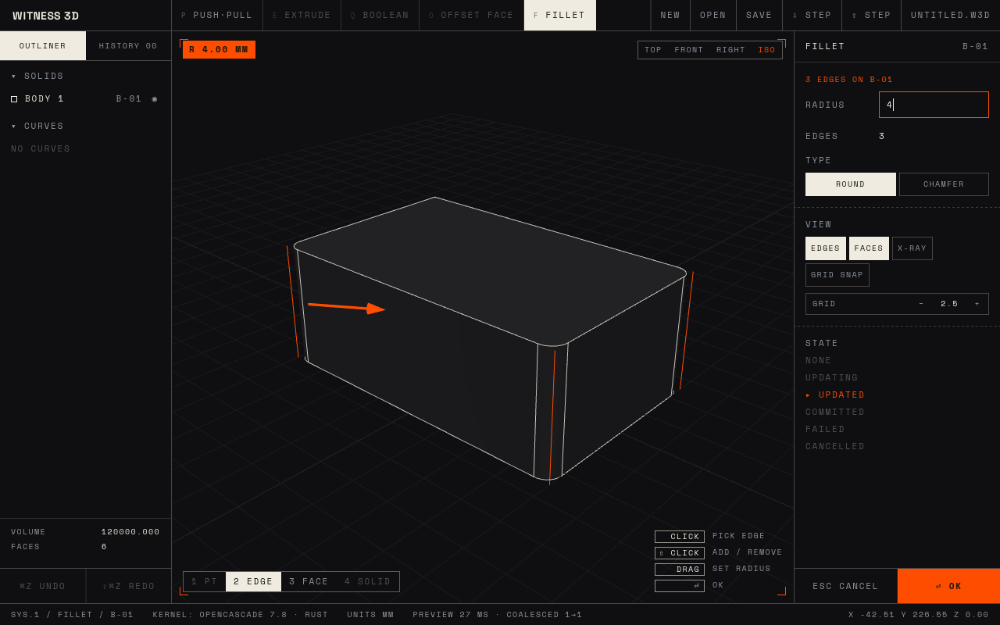

# Witness 3D desktop

The Rust modeling core (`crates/w3d-kernel`, OpenCascade) in a [Tauri](https://tauri.app) window,
with the same UI as the web page (`web/src/app`) as its face.



Geometry never runs in the page. The viewport sends each drag to Rust as an `ExtrudeRequest`. The
model lives on its own thread (`w3d_kernel::engine`), and when drags pile up behind a slow
boolean it computes only the newest and answers the rest with `null`. The HUD counts both. What
comes back is a mesh tagged with B-rep face ids and the plane of every flat face, which is how a
click knows where a sketch can go. Edges come back once each, in OpenCascade's numbering, so a
click on an edge names the edge a fillet or chamfer request sends back. A failed fillet returns
`{ message, edges }` so the viewport can say why and mark the edges the kernel blamed.

| File | What it does |
|---|---|
| `src-tauri/src/api.rs` | The commands as plain functions: scene, extrude and fillet/chamfer preview and commit, undo, redo, new, save, open, STEP import and export |
| `src-tauri/src/lib.rs` | Tauri wiring; each command waits on the model thread off the async runtime |
| `ui/main.js` | Mounts the shared UI with a backend that calls the Rust commands; bundles the fonts |
| `web/src/app/App.js` | The UI itself, shared with the web page: viewport, picking, outliner, history, inspector |

## Run

Linux needs the WebKitGTK headers first (`libwebkit2gtk-4.1-dev libgtk-3-dev librsvg2-dev`);
macOS and Windows need nothing extra. The first build compiles OpenCascade, which takes a while.

```sh
cd apps/desktop
npm install
npm run tauri dev       # live-reloading window
npm run tauri build     # installer in target/release/bundle
cargo test -p w3d-desktop --release   # the commands against real OpenCascade, no window
```
